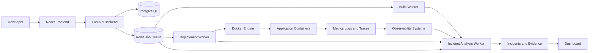

# Architecture

## Vision

ATLAS will provide a self-hosted reliability control plane that observes deployments, correlates operational evidence, diagnoses incidents, and supports human-approved recovery. It is not intended to compete with general-purpose application hosting platforms. The initial design is a modular monolith with independently running background workers.

## Initial Architecture

The FastAPI backend coordinates authenticated requests, domain workflows, evidence ingestion, incident analysis, persistence, job scheduling, recovery approvals, and audit records. PostgreSQL stores durable application, deployment, incident, and operational data. Redis carries background jobs and transient coordination state. Workers execute builds, deployment observations, telemetry processing, and incident-analysis tasks independently of request handling.

## Responsibilities and Boundaries

### API Gateway and Backend

The API will authenticate and authorize requests, validate input, expose project, deployment, incident, and recovery APIs, coordinate domain modules, persist state, enqueue jobs, and expose evidence and operational status. It must not execute arbitrary repository code, make unsupported diagnostic claims, or perform unbounded long-running work.

### Backend Modules

The planned modular boundaries are authentication and authorization, projects, GitHub integrations, builds, deployments, monitoring, logging, incident correlation, recovery actions, AI diagnostics, audit logging, and analytics. Modules should own their domain rules and communicate through explicit application interfaces.

### PostgreSQL

PostgreSQL will store users, projects, integrations, build and deployment records, telemetry references, incidents, evidence items, diagnostic hypotheses, recovery recommendations, configuration metadata, audit events, and other durable state. Schema changes will be managed through Alembic migrations.

### Redis and Background Jobs

Redis will support RQ-backed job queues, job status coordination, and short-lived operational state. It is not the source of truth for durable domain records.

### Build Worker

The build worker will retrieve approved build inputs and execute builds in isolated environments with explicit CPU, memory, filesystem, and network restrictions. Build output, status, and relevant failure evidence will be reported back through durable records and controlled interfaces.

### Deployment Worker

The deployment worker will observe and manage approved image and container lifecycle operations, deployment state transitions, health checks, and recovery actions such as rollback. It will enforce deployment policy rather than accepting arbitrary unchecked instructions. Consequential recovery actions require explicit human approval.

### Monitoring and Observability

Prometheus, Grafana, Loki, and OpenTelemetry are planned for metrics, dashboards, logs, traces, and service health. Application and platform telemetry should be correlated with projects, builds, deployments, dependencies, and incidents without coupling observability storage to request execution. The system should preserve timestamps, provenance, and relationships between signals so diagnostic conclusions remain inspectable.

### AI Diagnostic Engine

The AI diagnostic engine will be introduced after reliable logs, metrics, traces, audit data, and deployment context exist. It will construct evidence-backed hypotheses, identify conflicting signals, preserve uncertainty and provenance, and recommend recovery actions with risk information. It will not autonomously execute destructive actions by default.

### Security Boundaries

The API, workers, Docker engine, and application containers are separate trust boundaries. Secrets must be managed outside source control. Build and deployment operations require least privilege, input validation, resource limits, auditability, and explicit isolation from the API process.

## Planned Evolution

The modular monolith is the default starting point. Modules may become independently deployable only when incident-analysis scale, operational isolation, ownership boundaries, or deployment cadence creates a demonstrated need. The project will avoid premature microservices and preserve explicit contracts as the system grows.