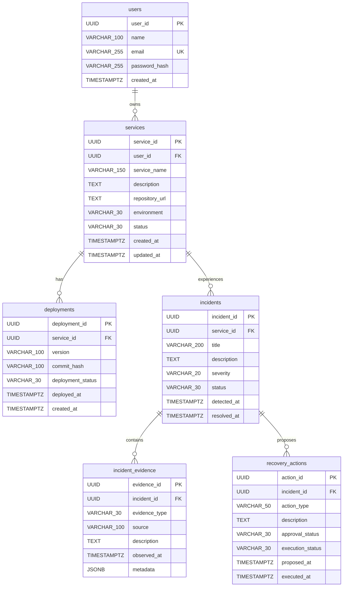

# Database Design

This document describes the initial PostgreSQL design for ATLAS 2.0. ATLAS is a self-hosted Deployment Reliability and Incident Intelligence Platform. The database is the durable system of record for users, services, deployments, incidents, evidence, and recovery actions. This is a documentation-only design; it does not define implemented database models or migrations.

## Database Concepts

A **database** is an organized system for storing, managing, and retrieving information. A relational database organizes information into related tables.

- A **table** represents a type of thing, such as a service or an incident.
- A **row** is one record in a table. One row in `services` represents one service.
- A **column** is one attribute of every row in a table, such as a service's name or creation time.
- A **primary key** uniquely identifies one row. Other tables can use that value to refer to the row.
- A **foreign key** stores a value that refers to a primary key in another table. It connects related records and helps PostgreSQL prevent references to records that do not exist.

## Entity Relationship Diagram

The diagram shows the six initial tables. The `||` side is one record and the `o{` side is zero or many records.

## Initial Tables

The proposed schema below is the starting design. `NOT NULL` means a value is mandatory. `NULL allowed` means the value is optional and may be absent. `PK` means primary key, `FK` means foreign key, and `UK` means a unique constraint.

### `users`

**Purpose:** Stores people who use ATLAS and own services.

| Column | PostgreSQL type | Required? | Key or constraint | Description | Example |
| --- | --- | --- | --- | --- | --- |
| `user_id` | `UUID` | Yes | Primary key | Unique identifier for the user. | `550e8400-e29b-41d4-a716-446655440000` |
| `name` | `VARCHAR(100)` | Yes | None | The user's display name. | `Aisha Khan` |
| `email` | `VARCHAR(255)` | Yes | Unique | The user's login email address. No two users may use the same address. | `aisha.khan@example.com` |
| `password_hash` | `VARCHAR(255)` | Yes | None | A one-way password hash used for authentication, never the plain-text password. | `$argon2id$v=19$m=65536,t=3,p=4$...` |
| `created_at` | `TIMESTAMPTZ` | Yes | None | The date and time when the user record was created. | `2026-11-09T10:00:00Z` |

### `services`

**Purpose:** Stores applications or operational services monitored and deployed through ATLAS.

| Column | PostgreSQL type | Required? | Key or constraint | Description | Example |
| --- | --- | --- | --- | --- | --- |
| `service_id` | `UUID` | Yes | Primary key | Unique identifier for the service. | `650e8400-e29b-41d4-a716-446655440001` |
| `user_id` | `UUID` | Yes | Foreign key -> `users.user_id` | Identifies the user who owns the service. | `550e8400-e29b-41d4-a716-446655440000` |
| `service_name` | `VARCHAR(150)` | Yes | None | Human-readable name of the service. | `Payments API` |
| `description` | `TEXT` | No | None | Optional description of the service's purpose. | `Processes checkout payments` |
| `repository_url` | `TEXT` | No | None | Optional source repository location. | `https://github.com/example/payments-api` |
| `environment` | `VARCHAR(30)` | Yes | Controlled value | Environment associated with the service, such as `production` or `staging`. | `production` |
| `status` | `VARCHAR(30)` | Yes | Controlled value | Current lifecycle or operational status of the service. | `active` |
| `created_at` | `TIMESTAMPTZ` | Yes | None | The date and time when the service was created. | `2026-11-09T10:05:00Z` |
| `updated_at` | `TIMESTAMPTZ` | Yes | None | The date and time when the service was last changed. | `2026-11-09T10:05:00Z` |

### `deployments`

**Purpose:** Stores deployment attempts and their outcomes for services.

| Column | PostgreSQL type | Required? | Key or constraint | Description | Example |
| --- | --- | --- | --- | --- | --- |
| `deployment_id` | `UUID` | Yes | Primary key | Unique identifier for the deployment record. | `750e8400-e29b-41d4-a716-446655440002` |
| `service_id` | `UUID` | Yes | Foreign key -> `services.service_id` | Identifies the service being deployed. | `650e8400-e29b-41d4-a716-446655440001` |
| `version` | `VARCHAR(100)` | Yes | None | Application or release version being deployed. | `2.4.0` |
| `commit_hash` | `VARCHAR(100)` | No | None | Optional source-control commit associated with the deployment. | `a1b2c3d4e5f6` |
| `deployment_status` | `VARCHAR(30)` | Yes | Controlled value | Current result or state of the deployment. | `succeeded` |
| `deployed_at` | `TIMESTAMPTZ` | No | None | The time the deployment completed or became active, when applicable. | `2026-11-09T10:20:00Z` |
| `created_at` | `TIMESTAMPTZ` | Yes | None | The time the deployment record was created. | `2026-11-09T10:15:00Z` |

### `incidents`

**Purpose:** Stores reliability incidents associated with services.

| Column | PostgreSQL type | Required? | Key or constraint | Description | Example |
| --- | --- | --- | --- | --- | --- |
| `incident_id` | `UUID` | Yes | Primary key | Unique identifier for the incident. | `850e8400-e29b-41d4-a716-446655440003` |
| `service_id` | `UUID` | Yes | Foreign key -> `services.service_id` | Identifies the service affected by the incident. | `650e8400-e29b-41d4-a716-446655440001` |
| `title` | `VARCHAR(200)` | Yes | None | Short summary of the incident. | `Payment API elevated error rate` |
| `description` | `TEXT` | No | None | Optional longer description of symptoms and impact. | `Checkout requests returned HTTP 500 responses.` |
| `severity` | `VARCHAR(20)` | Yes | Controlled value | Importance or impact level of the incident. | `high` |
| `status` | `VARCHAR(30)` | Yes | Controlled value | Current lifecycle state of the incident. | `investigating` |
| `detected_at` | `TIMESTAMPTZ` | Yes | None | The time the incident was detected. | `2026-11-09T10:30:00Z` |
| `resolved_at` | `TIMESTAMPTZ` | No | None | The time the incident was resolved, if it is resolved. | `2026-11-09T10:50:00Z` |

### `incident_evidence`

**Purpose:** Stores individual observations that help people and diagnostic systems investigate an incident.

| Column | PostgreSQL type | Required? | Key or constraint | Description | Example |
| --- | --- | --- | --- | --- | --- |
| `evidence_id` | `UUID` | Yes | Primary key | Unique identifier for the evidence record. | `950e8400-e29b-41d4-a716-446655440004` |
| `incident_id` | `UUID` | Yes | Foreign key -> `incidents.incident_id` | Identifies the incident to which the evidence belongs. | `850e8400-e29b-41d4-a716-446655440003` |
| `evidence_type` | `VARCHAR(30)` | Yes | Controlled value | Category of observation, such as `log`, `metric`, or `trace`. | `metric` |
| `source` | `VARCHAR(100)` | Yes | None | System that produced or supplied the observation. | `Prometheus` |
| `description` | `TEXT` | Yes | None | Human-readable description of the observation. | `HTTP 500 rate increased above 8 percent.` |
| `observed_at` | `TIMESTAMPTZ` | Yes | None | The time when the observation occurred or was measured. | `2026-11-09T10:31:00Z` |
| `metadata` | `JSONB` | No | None | Optional structured details whose shape may differ by evidence type. | `{"metric":"http_5xx_rate","value":0.08}` |

### `recovery_actions`

**Purpose:** Stores proposed and executed actions intended to recover a service during an incident.

| Column | PostgreSQL type | Required? | Key or constraint | Description | Example |
| --- | --- | --- | --- | --- | --- |
| `action_id` | `UUID` | Yes | Primary key | Unique identifier for the recovery action. | `a50e8400-e29b-41d4-a716-446655440005` |
| `incident_id` | `UUID` | Yes | Foreign key -> `incidents.incident_id` | Identifies the incident that led to the action. | `850e8400-e29b-41d4-a716-446655440003` |
| `action_type` | `VARCHAR(50)` | Yes | Controlled value | Kind of recovery action, such as `rollback` or `restart`. | `rollback` |
| `description` | `TEXT` | Yes | None | Details of the proposed or executed action. | `Rollback to version 2.3.9.` |
| `approval_status` | `VARCHAR(30)` | Yes | Controlled value | Whether the action is awaiting approval, approved, or rejected. | `approved` |
| `execution_status` | `VARCHAR(30)` | Yes | Controlled value | Whether execution is pending, running, successful, or failed. | `succeeded` |
| `proposed_at` | `TIMESTAMPTZ` | Yes | None | The time the action was proposed. | `2026-11-09T10:35:00Z` |
| `executed_at` | `TIMESTAMPTZ` | No | None | The time the action finished executing, if it was executed. | `2026-11-09T10:45:00Z` |

## Relationships

Each relationship below is one-to-many. One parent record may have zero, one, or many child records, while each child record refers to one parent through a foreign key.

- One user can own multiple services. `services.user_id` references `users.user_id`.
- One service can have multiple deployments. `deployments.service_id` references `services.service_id`.
- One service can experience multiple incidents. `incidents.service_id` references `services.service_id`.
- One incident can have multiple evidence records. `incident_evidence.incident_id` references `incidents.incident_id`.
- One incident can have multiple recovery actions. `recovery_actions.incident_id` references `incidents.incident_id`.

For example, the primary key `services.service_id` identifies one service. Every matching `deployments.service_id` value identifies a deployment belonging to that service. PostgreSQL foreign-key integrity prevents a deployment from referring to a service that is not present in `services`.

## Design Decisions

### UUID Identifiers

UUIDs provide globally unique identifiers without requiring the database to reveal how many records exist or coordinate simple sequential numbers across systems. They are useful for self-hosted installations and distributed workers. UUIDs are less readable than small integers, so the application should use names and titles for display while using UUIDs for references.

### `TIMESTAMPTZ` Timestamps

`TIMESTAMPTZ` stores an instant in time while handling timezone conversion correctly. ATLAS should write and display timestamps in UTC by default so events from different services, hosts, and time zones can be compared consistently.

### Password Hashes

The database stores `password_hash`, not a plain-text password. A strong password-hashing algorithm such as Argon2id should produce the hash. If the database is exposed, hashes are still sensitive, but the original passwords are not directly readable from the stored value. Passwords must never be logged or stored in plain text.

### Flexible Evidence Metadata

Evidence from logs, metrics, and traces does not always have the same fields. `JSONB` allows each evidence record to retain structured details appropriate to its type while keeping the main evidence columns consistent. Frequently queried metadata may later receive a targeted index, but flexible metadata should not replace well-defined columns for core relationships or lifecycle fields.

### Observability Data

Logs and metrics can be high-volume, time-series-oriented data that require specialized retention, aggregation, and query capabilities. ATLAS should reference or summarize this data in `incident_evidence` rather than storing every log line and metric sample directly in PostgreSQL. Systems such as Loki and Prometheus are better suited to storing and querying those raw observability streams.

### Separate Evidence and Recovery Actions

Evidence describes what was observed. A recovery action describes what ATLAS proposed or executed in response. Keeping them in separate tables allows one incident to retain many observations and many actions without mixing facts with decisions. It also supports an auditable history of recommendations, approvals, and execution outcomes.

## Database Conventions

- Use lowercase `snake_case` for table and column names.
- Use UUID primary keys for the six initial tables.
- Define foreign keys for every relationship and preserve referential integrity. A child record must not point to a missing parent record.
- Add indexes for foreign keys and for frequently queried columns such as incident status, severity, detected time, and deployment status. Indexes should be added for demonstrated query needs rather than indiscriminately.
- Store and compare timestamps in UTC. Use `TIMESTAMPTZ` for values representing an instant in time.
- Protect passwords, tokens, repository credentials, and other sensitive values. Do not store plain-text passwords or expose secrets in evidence, logs, or sample data.
- Use controlled values for `severity`, lifecycle `status` columns, `deployment_status`, `approval_status`, `execution_status`, `evidence_type`, and `action_type`. The allowed values should be defined and validated by the application or database constraints as the design is implemented.

## Illustrative Sample Data

The following values are illustrative examples, not actual database records. They show consistent foreign-key references across the six tables.

### Users

| user_id | name | email |
| --- | --- | --- |
| `550e8400-e29b-41d4-a716-446655440000` | Aisha Khan | `aisha.khan@example.com` |

### Services

| service_id | user_id | service_name | environment | status |
| --- | --- | --- | --- | --- |
| `650e8400-e29b-41d4-a716-446655440001` | `550e8400-e29b-41d4-a716-446655440000` | Payments API | production | active |
| `660e8400-e29b-41d4-a716-446655440006` | `550e8400-e29b-41d4-a716-446655440000` | Web Dashboard | production | active |

### Deployments

Both deployments belong to the Payments API service.

| deployment_id | service_id | version | deployment_status |
| --- | --- | --- | --- |
| `750e8400-e29b-41d4-a716-446655440002` | `650e8400-e29b-41d4-a716-446655440001` | `2.3.9` | succeeded |
| `760e8400-e29b-41d4-a716-446655440007` | `650e8400-e29b-41d4-a716-446655440001` | `2.4.0` | succeeded |

### Incident

| incident_id | service_id | title | severity | status |
| --- | --- | --- | --- | --- |
| `850e8400-e29b-41d4-a716-446655440003` | `650e8400-e29b-41d4-a716-446655440001` | Payment API elevated error rate | high | investigating |

### Incident Evidence

Both evidence records belong to the incident above.

| evidence_id | incident_id | evidence_type | source | description |
| --- | --- | --- | --- | --- |
| `950e8400-e29b-41d4-a716-446655440004` | `850e8400-e29b-41d4-a716-446655440003` | metric | Prometheus | HTTP 500 rate increased above 8 percent. |
| `960e8400-e29b-41d4-a716-446655440008` | `850e8400-e29b-41d4-a716-446655440003` | log | Loki | Payment database connection timeout observed. |

### Recovery Action

| action_id | incident_id | action_type | approval_status | execution_status |
| --- | --- | --- | --- | --- |
| `a50e8400-e29b-41d4-a716-446655440005` | `850e8400-e29b-41d4-a716-446655440003` | rollback | approved | succeeded |

## Glossary

- **Database:** An organized system for storing and retrieving information.
- **Table:** A named collection of related records with the same columns.
- **Row:** One record in a table.
- **Column:** One named attribute stored for each row.
- **Primary key:** A value that uniquely identifies one row in a table.
- **Foreign key:** A value that refers to a primary key in another table and connects related records.
- **UUID:** A 128-bit identifier designed to be unique across systems, commonly written as a sequence of hexadecimal groups.
- **JSONB:** PostgreSQL's binary JSON type for storing structured data with a flexible shape.
- **Index:** An additional database structure that helps PostgreSQL find rows faster for particular queries, at the cost of storage and write overhead.
- **One-to-many relationship:** A relationship where one parent row can be related to many child rows, while each child row belongs to one parent row.
