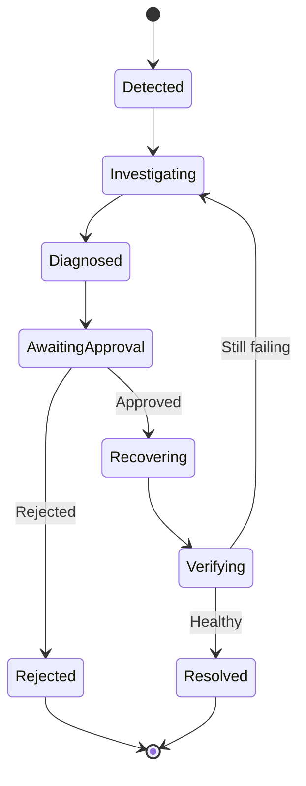

# Incident Lifecycle

This document defines the planned lifecycle of an ATLAS incident from initial detection through investigation, diagnosis, human-approved recovery, and resolution. ATLAS is currently documentation-only; the states and transitions describe the intended behavior, not implemented functionality.

## Lifecycle Diagram

## States

### Detected

ATLAS identifies an abnormal condition from application signals, health checks, alerts, deployment changes, or resource behavior. The system creates an incident record with the initial evidence and detection time.

### Investigating

ATLAS collects and organizes related evidence, including logs, metrics, traces, deployment records, build results, dependency health, and resource signals. New evidence may be added while the incident remains under investigation.

### Diagnosed

The diagnosis engine has produced one or more ranked hypotheses. Each hypothesis should include supporting evidence, conflicting evidence where available, provenance, timestamps, and an explicit confidence or uncertainty description.

### Awaiting Approval

ATLAS has produced one or more recovery recommendations and is waiting for an authorized human decision. Recommendations may include rollback, restart, configuration correction, or escalation, together with expected impact and risk information.

### Recovering

An authorized person has approved a bounded recovery action. The recovery worker executes the approved action through a controlled interface and records progress, output, and failures.

### Verifying

ATLAS evaluates application and dependency health after recovery. Verification uses relevant signals such as error rate, latency, health checks, resource behavior, and dependency availability.

### Resolved

Health verification indicates that the incident conditions have recovered. ATLAS records the resolution time, verification evidence, recovery action, and final decision history.

### Rejected

An authorized person rejected the proposed recovery action. ATLAS records the rejection and preserves the incident evidence, diagnosis, recommendation, and decision for audit and later review. A rejected incident is not considered resolved by the platform.

## Transition Rules

- Detection must create an auditable incident record before investigation begins.
- Investigation may collect evidence asynchronously and must preserve signal timestamps and provenance.
- A diagnosis must be based on available evidence and must represent uncertainty rather than claim unsupported certainty.
- Recovery recommendations are proposals and never execute automatically by default.
- Only an authorized human approval can move an incident from `AwaitingApproval` to `Recovering`.
- A rejected recommendation must not invoke the recovery worker.
- Recovery must transition to verification before the incident can be marked resolved.
- If verification shows that the application is still failing, the incident returns to `Investigating` with the new recovery evidence attached.
- Resolution requires positive health evidence and must not be inferred solely from successful command execution.

## Audit Requirements

Each incident should retain an immutable or append-only history of:

- Detection events and initial evidence.
- Investigation updates and correlated signals.
- Diagnostic hypotheses and their evidence references.
- Recovery recommendations and risk information.
- Approval or rejection decisions, including the acting identity and timestamp.
- Recovery execution results.
- Health verification results and resolution status.
